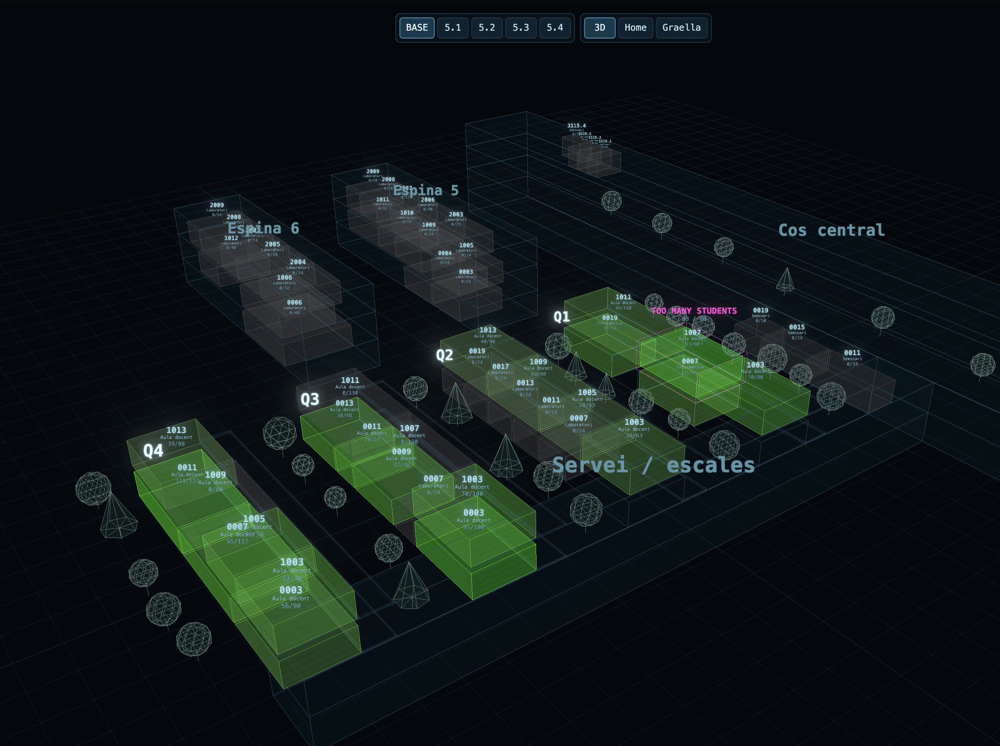

# PHPwarriors

UAB project for **UAB The Hack 2026**

| Level | Question | Where |
|---|---|---|
| **1 · Data analysis** | How are the rooms used today, and does the new model fit? | `analisi/nivell1.py` → [`docs/NIVELL1.md`](docs/NIVELL1.md) |
| **2 · Timetable** | Build valid timetables for questions 5.1-5.4 | `final/solver/` → [`final/solver/README.md`](final/solver/README.md) |
| **3 · AI** | How can AI help Gestió Acadèmica? | `ornith/` → [`docs/NIVELL3.md`](docs/NIVELL3.md) |

On top of that there is a **web app** (`web/`): a 3D hologram of the building, a weekly timetable grid and the Ornith
chat, all reading one DuckDB database.



## Repository layout

```
PHPwarriors/
├── README.md               this file
├── requirements.txt        Python packages (pip install -r requirements.txt)
├── .env.example            template for .env (LLM key for Ornith)
│
├── final/                  what is handed in
│   ├── paquet/             INPUT: the challenge data folder (CSVs + scenarios). Source of truth, never edited.
│   │   └── DICCIONARI.md   what every file and column means
│   ├── horaris/            copy of the official verifier, used by the solver's Makefile
│   ├── solver/             LEVEL 2: SAT timetable generator (Prolog + kissat), its own Makefile and README
│   │   └── out/<q>/        the proposals for 5.1 · 5.2 · 5.3 · 5.4 (committed)
│   └── LLIURAMENT/         the delivery: proposals, verifier reports and answers (built by solver/lliurament.py)
├── horaris/                the official verifier (python -m horaris check ...). Checks any proposal.
│
├── analisi/nivell1.py      LEVEL 1: the 5 findings about today's room use
├── entregues/              copies of the proposals uploaded to the xaman (the file name holds the score)
├── database/               DuckDB: build it, add the solver's views, and every query the app uses
│   ├── migra_duckdb.py     final/paquet/ -> dades/paquet.duckdb
│   ├── crea_vistes.py      final/solver/out/<q>/proposta.csv -> views sessions51..sessions54
│   └── consultes.py        the queries (used by web/ and prototips/)
├── dades/                  GENERATED, not in git: paquet.duckdb, registre_canvis.csv
├── web/                    WEB APP: server + pages (see web/README.md)
│   ├── server.py, db.py    HTTP server and API
│   ├── html/  css/  js/  img/
│   └── layout.json         3D geometry of every room
├── ornith/                 LEVEL 3: the Ornith assistant (tools, agent, contingencies, tests)
├── prototips/              first LLM experiments, superseded by ornith/ (kept for reference)
└── docs/                   statement, NIVELL1.md, NIVELL3.md, DB schema (esquema_bd.mermaid), ocupacio.png
```

`final/solver/` reads `final/paquet/` and runs the verifier in `final/horaris/` (its Makefile works from `final/`).
`make bucle` and `make any` leave their copies in `final/entregues/`; the root `entregues/` keeps the older uploads.

## Getting started, in order

Run every command **from the project root** unless a step says otherwise.

### 0. What you need

- **Python 3.10 or newer** (the team uses 3.12).
- Only for regenerating level 2: **make**, **SWI-Prolog** (`swipl`) and **kissat** on the `PATH`
  (macOS: `brew install swi-prolog kissat`; Linux / WSL: your package manager). You can skip this: the solver's
  results are already committed in `final/solver/out/`.
- Only for the Ornith chat with the LLM: the event's LLM gateway key (`UTH_KEY`).

### 1. Python environment

```bash
python3 -m venv .venv
source .venv/bin/activate          # Windows: .venv\Scripts\activate
pip install -r requirements.txt
```

Activate the venv (`source .venv/bin/activate`) in every new terminal. Your prompt then starts with `(.venv)`.

### 2. LLM key (optional, only for Ornith)

```bash
cp .env.example .env               # then write UTH_KEY=<key> in .env
```

`.env` is not committed. Everything except the chat with the LLM works without it.

### 3. Check the data with the official verifier

The verifier is the same code the jury uses. Run it on today's timetable to see the starting point:

```bash
python -m horaris check final/paquet/proposta_partida.csv --semestre 2
```

It says **NO VALIDA**: 2,008 sessions in the wrong shift (R1-TORN), 4,541 sessions with no room (R5-SENSE-AULA)… That
is the problem levels 1 and 2 deal with. Options: `--relaxacions`, `--escenari`, `--referencia`, `--nomes-aules`,
`--json`, `--violacions` (`python -m horaris check -h`).

### 4. Level 1 · data analysis

```bash
python analisi/nivell1.py
```

Prints the figures of the 5 findings and redraws the heat map `docs/ocupacio.png`. The conclusions are written up in
[`docs/NIVELL1.md`](docs/NIVELL1.md).

### 5. Level 2 · timetables (optional)

The proposals are already in `final/solver/out/5.1` … `final/solver/out/5.4`. To rebuild them you need `make`, `swipl` and
`kissat` (step 0):

```bash
cd final/solver
make 5.1            # rooms only                       ~10 s
make 5.2            # new shifts + summary for the Junta ~3-5 min
make 5.3            # contingencies, on top of 5.2      ~30 s
make 5.4            # new degree, on top of 5.2         ~30 s
make tot            # all of them + the weekly grid
python3 lliurament.py   # rebuild final/LLIURAMENT from out/ (after make tot)
cd ../..
```

Each `final/solver/out/<q>/` holds what is handed in: `proposta.csv`, `relaxacions.csv` (not in 5.1) and the verifier's report
(`informe.json`, `violacions.csv`). Every option, the model and the relaxations are explained in
[`final/solver/README.md`](final/solver/README.md).

### 6. Build the database

```bash
python database/migra_duckdb.py
```

Loads `final/paquet/` into `dades/paquet.duckdb` and adds the views `sessions51` … `sessions54` from the solver's
proposals. The web app needs it. Rebuild it whenever `final/paquet/` changes. When only the solver's proposals changed (step 5),
refreshing the views is enough:

```bash
python database/crea_vistes.py          # all questions; or e.g. python database/crea_vistes.py 5.2
```

### 7. Web app: hologram, grid and chat

```bash
python web/server.py 8000
```

| Page | URL |
|---|---|
| 3D hologram of the building | http://localhost:8000/ |
| Home | http://localhost:8000/home.html |
| Weekly timetable grid | http://localhost:8000/graella.html |

The bar at the top switches between today's timetable (`BASE`) and the proposals `5.1` … `5.4`. The 💬 button opens
the Ornith chat (needs `.env`). The server reloads the data on its own when the database changes. Pages, API and 3D
layout: [`web/README.md`](web/README.md).

### 8. Level 3 · Ornith

```bash
python -m ornith "On té classe el grup 81 dimarts?"                         # ask the agent (needs .env)
python -m ornith eina aules_lliures '{"hora": "10:00", "dia": "J", "places_min": 60}'   # one tool, no LLM
python -m ornith imprevist-aula Q1/1003 2027-03-10 --motiu "Projector avariat"        # a contingency
python -m ornith.proves                                                     # tests (add --llm to ask the LLM too)
```

Ornith reads the CSVs in `final/paquet/` and `final/solver/out/` directly. It does not need the database. Tools, the post-check that rejects
made-up rooms or sessions, and the demo script are in [`docs/NIVELL3.md`](docs/NIVELL3.md).

## Every script, in the order you would use it

| # | Command | Reads | Writes |
|---|---|---|---|
| 1 | `python -m horaris check <proposta.csv> …` | `final/paquet/`, a proposal | report on screen (`--json`, `--violacions`) |
| 2 | `python analisi/nivell1.py` | `final/paquet/sessions.csv`, `aules.csv` | figures on screen, `docs/ocupacio.png` |
| 3 | `cd final/solver && make <q>` | `final/paquet/`, `final/horaris/` | `final/solver/out/<q>/`, copies in `final/entregues/` (`make bucle`, `make any`) |
| 4 | `python database/migra_duckdb.py` | `final/paquet/`, `final/solver/out/` | `dades/paquet.duckdb` |
| 5 | `python database/crea_vistes.py [q]` | `final/solver/out/<q>/proposta.csv` | views `sessions5X` in the database |
| 6 | `python web/server.py [port]` | `dades/paquet.duckdb`, `web/` | nothing (read-only) |
| 7 | `python -m ornith …` | `final/paquet/`, `final/solver/out/`, `.env` | `dades/registre_canvis.csv` (only with `--desa`) |
| 8 | `python -m ornith.proves [--llm]` | `final/paquet/`, `final/solver/out/5.2/` | nothing |
| – | `python prototips/agent_tools.py sessio S09642` | `dades/paquet.duckdb` | nothing (first prototype of the tools) |
| – | `python prototips/test_tools.py` | `.env` | nothing (first prototype of the chat, interactive) |

## DuckDB database

`database/migra_duckdb.py` loads everything in `final/paquet/` (CSVs, `cobertura.json` and the scenarios) into one DuckDB
file, `dades/paquet.duckdb`. The CSVs stay the source of truth, and the verifier (`python -m horaris`) still reads them
directly. The database is rebuilt from scratch on every run and is not committed to git. The schema is drawn in
[`docs/esquema_bd.mermaid`](docs/esquema_bd.mermaid).

Tables: `sessions`, `aules`, `activitats`, `proposta_partida`, `plans`, `calendari`, `cobertura`, `escenaris`,
`escenari_aules_tancades`, `escenari_alumnes`, `escenari_cancellades`, `escenari_sessions_extra`.

Types: dates are `DATE`, `HH:MM` times are `TIME`, counts are `INTEGER`, 0/1 flags (`ordinaria`, `sense_espai`) are
`BOOLEAN`, and `|`-separated fields (`docents`, `plans`, `titulacions_curs`, `aules_addicionals_partida`,
`aules_partida`) are lists (`VARCHAR[]`). Codes such as `codi` and `pla` stay as text.

Derived columns, following the challenge rules (statement, section 8.3), on `sessions` and `escenari_sessions_extra`:

- `sem`: 1 or 2 by date (1st semester = September to January). Use it instead of `semestre`, which is wrong for 54
  sessions.
- `torn_actual`: `mati` if the session starts before 14:30, otherwise `tarda`. Compare it with `torn_requerit` for R1.

Views `sessions51` to `sessions54`: the sessions as the solver's proposal for questions 5.1-5.4 leaves them
(`final/solver/out/<q>/proposta.csv`, columns `id_sessio,dia,h_ini,aula`). Same columns as `sessions`, with `dia`, `h_ini`,
`aula_partida` from the proposal and `data`, `h_fi`, `sem`, `torn_actual` recomputed; 5.3 and 5.4 also apply their
scenario (new student counts, the new degree's sessions). `database/crea_vistes.py` builds them, and
`database/migra_duckdb.py` calls it too. The functions in `database/consultes.py` pick a view with their `vista`
parameter.

Querying from Python:

```python
import duckdb
con = duckdb.connect("dades/paquet.duckdb", read_only=True)
con.execute("""
    SELECT tipus, count(*) AS sense_aula
    FROM sessions
    WHERE aula_partida IS NULL AND NOT sense_espai
    GROUP BY tipus
""").df()
```

Note: DuckDB 2.0 removed `fetchone()` / `fetchall()` on `con.sql(...)` relations. Use `con.execute(...).fetchone()`
or `.df()` instead.

## Python environment: day to day

**Adding a package:**

```bash
pip install <package>
pip freeze > requirements.txt
```

Commit `requirements.txt` so the rest of the team gets it with `pip install -r requirements.txt`.

**What git ignores** (`.gitignore`): virtual environments (`.venv/`, and the `bin/`, `lib/`… of a venv made in the
root), secrets (`.env`), generated files (`*.duckdb`, `__pycache__/`, caches), the plan PDFs (`docs/planols/`), the
contingency log (`dades/registre_canvis.csv`), editor settings and `.DS_Store`.

**Committed the venv by mistake?** If `git status` shows thousands of files under `.venv/`, `bin/` or `lib/`:

- Not pushed yet: `git reset HEAD~1` (your files stay on disk).
- Already pushed: `git rm -r --cached .venv` and commit. Check first that `.gitignore` lists the venv folder.
